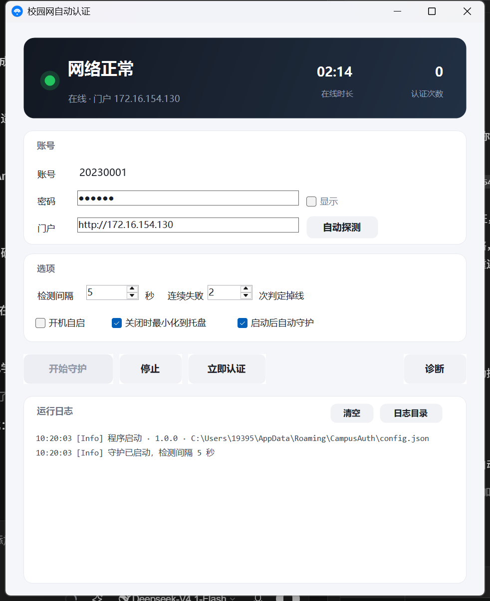

# 校园网自动认证

针对**深澜 SRun 门户**（`SRun3KPortal` 客户端所用的那套认证系统）写的 Windows 自动认证工具。
守护进程每隔几秒探测一次网络，一旦上不了网就自动向门户发起登录；会话被踢下线也会自动重连。

不需要开着官方客户端。



## 功能

| 功能 | 说明 |
| --- | --- |
| 断网检测 | 默认 5 秒一次，连续 2 次失败才判定掉线，避免误判 |
| 自动认证 | 新版 challenge 协议（`get_challenge` → HMAC-MD5 密码 + SRBX1 info + SHA1 签名），自动兼容老版协议与 `do_login` 接口 |
| 门户探测 | 依次尝试：跟随劫持跳转 → 页面 meta 跳转 → DNS 劫持解析 → 网关常见地址 |
| 即时响应 | 网络状态变化（插拔网线、切 WiFi、休眠唤醒）立刻触发检测，不等下一轮 |
| 失败退避 | 账号密码被拒时暂停 2 分钟再试，避免把账号试锁；其他失败连续 5 轮后退避 1 分钟 |
| 会话保活 | 默认 5 分钟访问一次门户，防止空闲被踢（可关） |
| 备用方案 | 自动认证失败时，可以改为启动官方客户端兜底 |
| 托盘常驻 | 图标颜色跟随状态，关窗最小化，双击托盘恢复 |
| 日志 | `%APPDATA%\CampusAuth\logs\`，按天分文件，保留 7 天 |

## 使用

1. 双击 `CampusAuth.exe`
2. 填 **账号**、**密码**
3. **门户** 留空即可（断网时自动探测）；探测不到就填浏览器认证页的地址，例如 `http://10.10.10.10`
4. 勾选 **开机自启**（可选）
5. 点 **开始守护**

密码用本机信息派生的密钥 AES 加密后存在 `%APPDATA%\CampusAuth\config.json`，换电脑需要重填。

### 命令行

```
CampusAuth.exe           正常启动
CampusAuth.exe --min     静默启动（只留托盘，开机自启用的就是这个）
CampusAuth.exe --diag    跑一遍诊断，结果写到 %APPDATA%\CampusAuth\diag.txt
```

## 认证协议

深澜门户有两套并存的协议，程序会先试新版、失败再回退。

### 新版（带 challenge）

流程取自门户自己的 `jquery.srun.portal.js`：

1. `GET /cgi-bin/get_challenge?username=&ip=` → 拿到 `challenge`（token）和 `client_ip`
2. `hmd5 = HMAC-MD5(key=token, msg=密码)`
3. `info = "{SRBX1}" + base64_custom(xEncode(JSON{username, 密码明文, ip, acid, enc_ver}, key=token))`
4. `chkstr = token+u + token+hmd5 + token+acid + token+ip + token+200 + token+1 + token+info`
5. `chksum = SHA1(chkstr)`
6. `GET /cgi-bin/srun_portal?action=login&username&password={MD5}hmd5&ac_id&ip&chksum&info&n=200&type=1&os&name&double_stack=0`

### 老版（无 challenge）

`chksum = HMAC-MD5(用户名+密码+ac_id+ip+200+1+info, key="srun")`，info 用固定密钥 `srun_bx1` 编码。

### 自定义 base64

字母表为 `LVoJPiCN2R8G90yg+hmFHuacZ1OWMnrsSTXkYpUq/3dlbfKwv6xztjI7DeBE45QA`，
`xEncode` 是 TEA 的一个变体，实现见 `src/SrunCrypto.cs`。

## 配置文件

`%APPDATA%\CampusAuth\config.json`

| 字段 | 说明 |
| --- | --- |
| `Username` / `PasswordCipher` | 账号 / 加密后的密码 |
| `PortalUrl` | 门户地址，留空自动探测 |
| `AcId` | 认证域，0 为自动获取 |
| `ProbeUrl` | 自定义联网检测地址，留空用内置的 |
| `IntervalSeconds` / `FailThreshold` | 检测间隔 / 连续失败几次判定掉线 |
| `KeepAliveSeconds` | 保活间隔，0 关闭 |
| `FallbackEnabled` / `FallbackCommand` | 失败时启动官方客户端 |
| `AutoStart` / `AutoRun` / `MinimizeToTray` | 开机自启 / 启动即守护 / 关窗最小化 |

## 编译

需要 [.NET 9 SDK](https://dot.net)：

```bash
build.cmd
```

产物在 `dist/CampusAuth.exe`：单文件、自带运行时、约 48 MB，目标机器不用装 .NET。

## 测试

`tests/` 下有一个模拟深澜门户（会独立校验 chksum），三套测试都基于它：

```bash
python tests/mock_portal.py 8899                        # 终端 1：模拟门户

dotnet run -c Release --project tests/CryptoTests       # 加密算法与参考实现逐字节比对
dotnet run -c Release --project tests/FlowTests         # 新版/老版协议、密码错误、回退、状态查询
dotnet run -c Release --project tests/GuardianTests     # 断网→认证→在线→暂停恢复→被踢重连
```

对真实门户联调：

```bash
dotnet run -c Release --project tests/LiveTest -- http://10.10.10.10 账号 密码 1
dotnet run -c Release --project tests/SetupConfig -- 账号 密码 http://10.10.10.10 1
```

## 说明

- 只适配深澜（SRun）系统。Dr.COM、锐捷等协议不同，需要改 `src/SrunClient.cs`。
- 走网页门户接口，不依赖官方客户端进程。
- 仅供自己的账号自动登录使用，请勿用于批量登录他人账号。
- 门户若启用了验证码或短信二次验证，本工具无法通过。

## License

MIT
